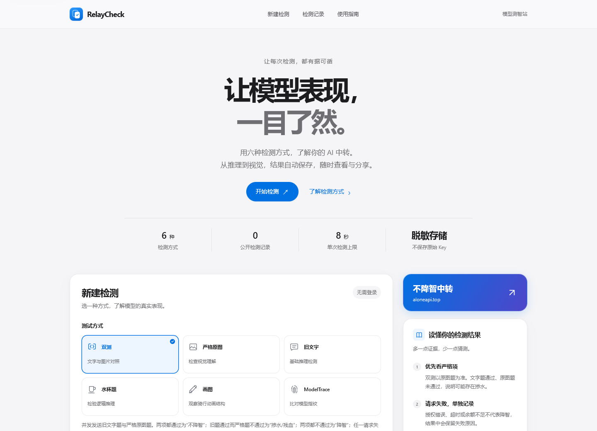
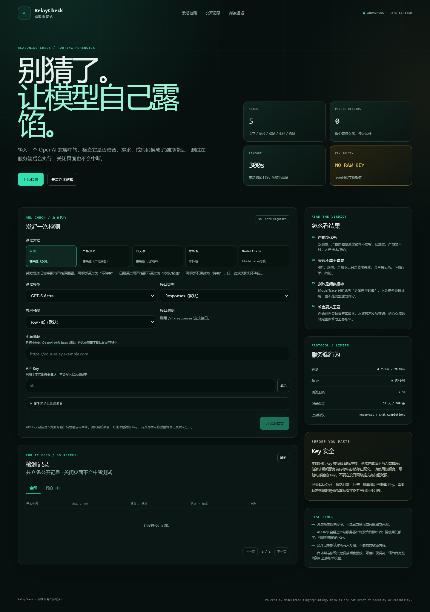
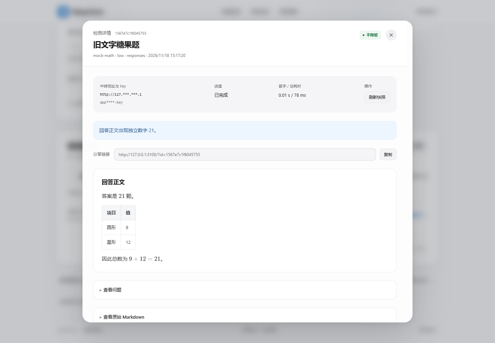
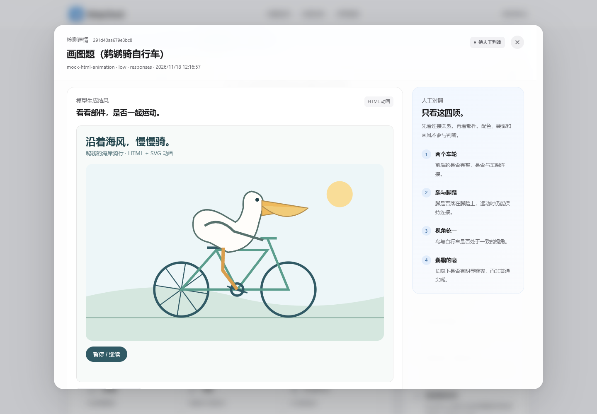

<div align="center">
  
  <h1>RelayCheck</h1>
  <p><strong>模型测智站 · 让每次检测，都有据可循。</strong></p>
  <p>面向 OpenAI 兼容中转的推理、视觉与模型指纹检测工具</p>
  <p>
    <a href="https://nodejs.org/"></a>
    <a href="https://vuejs.org/"></a>
    <a href="https://www.typescriptlang.org/"></a>
    <a href="https://www.sqlite.org/"></a>
    <a href="docs/DEPLOY.md"></a>
    <a href="LICENSE"></a>
  </p>
  <p>
    <a href="#社区交流"></a>
  </p>
  <p>
    <a href="#快速开始">快速开始</a> ·
    <a href="#界面预览">界面预览</a> ·
    <a href="#检测方式">检测方式</a> ·
    <a href="docs/DEPLOY.md">部署文档</a> ·
    <a href="docs/API.md">API 文档</a> ·
    <a href="#社区交流">社区交流</a>
  </p>
  <p><sub>六种检测方式 · 服务端后台执行 · 结果可追溯 · 自托管部署</sub></p>
</div>

---

RelayCheck 帮助你检查 AI 中转的回答表现与模型路由是否符合预期。填入中转地址、API Key 和模型 ID，即可运行检测、查看完整证据并分享结果。支持 **Responses** 与 **Chat Completions**，无需登录。

> 检测结果是辅助判断的依据，不是模型身份或能力证明。请求失败会单独记录，画图题由用户人工判读。

## 项目特性

| 能力 | 说明 |
| --- | --- |
| **多维度检测** | 糖果文字题、严格原图、双测、水杯题、鹈鹕动画和 ModelTrace 指纹，共六种模式。 |
| **后台持续执行** | 关闭或刷新页面不中断任务；默认 300 秒超时，详情通过 SSE 更新并支持快照回退。 |
| **完整结果留存** | 保存问题、回答、子测试、错误和指纹，支持 Markdown、数学公式及 `?id=` 分享。 |
| **动画与人工对照** | 按 Cockpit Tools 的题目和交付指令生成动画，HTML 与独立 SVG 均在沙箱中运行；支持停止、重播及源码查看。 |
| **隐私与访问防护** | Key 和中转地址脱敏存储，提供 SSRF 校验、限流、并发控制及隔离渲染。 |
| **轻量自托管** | Vue 3 + TypeScript + Fastify + SQLite，支持 Docker Compose / Caddy，适配桌面和手机。 |

## 快速开始

要求 **Node.js 24+**，建议使用项目锁定的 **pnpm 11.28.5**。已有 `.env` 时请保留现有配置。

```bash
git clone https://github.com/zhaoquan1003-cpu/RelayCheck.git
cd RelayCheck
pnpm install --frozen-lockfile
cp .env.example .env
pnpm dev
```

Windows PowerShell 可用 `Copy-Item .env.example .env` 复制配置。开发环境前端为 <http://127.0.0.1:5173>，API 为 <http://127.0.0.1:3000>。

**生产构建并启动：**

```bash
pnpm build
pnpm start
```

`pnpm start` 自动启用生产模式并读取 `.env`，由 Fastify 托管前端和 API。直接运行 `node dist/server/index.js` 时，需要显式设置 `NODE_ENV=production`。

### Docker Compose

复制并编辑 `.env.example` 为 `.env`，将 `SITE_ADDRESS` 设置为已解析到服务器的域名，再执行：

```bash
docker compose --env-file .env -f deploy/docker-compose.yml up -d --build
```

Caddy 自动管理 HTTPS；数据库保存于命名卷。本地 HTTP 预览可设 `SITE_ADDRESS=http://localhost`。完整代理、备份、升级及 systemd 配置见 [部署文档](docs/DEPLOY.md)。

## 界面预览

截图来自本地模拟测试环境；其中的地址、回答与限额用于演示。

<p align="center">
  
</p>

<details>
<summary><strong>查看完整首页与最新侧栏入口</strong></summary>



</details>

<details>
<summary><strong>查看测试详情与动画判读界面</strong></summary>





动画截图使用本地模拟上游的演示内容。

</details>

## 使用流程

1. **选择检测方式**：默认是糖果题“双测”；严格原图与双测需要模型支持图片输入。
2. **填写连接参数**：先填入中转地址与 API Key，点击“获取模型”后选择要测试的模型，再选择接口和思考强度。也可直接使用预设或自定义模型 ID。默认使用 `responses`、`gpt-6-astra`、`low`。
3. **提交后台任务**：可先展开题目预览。提交成功后输入框清空 Key，任务在服务端继续执行。
4. **查看与分享结果**：在详情中查看回答、子测试、错误或指纹，复制链接即可分享。画图题由用户人工判读，也可参考本站四项结构观察建议。

模型预设覆盖 GPT、Claude、DeepSeek、GLM、Kimi 等示例；实际可用模型和参数由中转决定，命名不一致时使用“自定义模型”。

“我的测试”仅在当前浏览器保存最近 **100 个记录 ID**，回答与结果仍保存在服务端。清除浏览器数据会丢失本地索引。首页侧栏提供标注为“不降智中转”的 [aloneapi.top](https://aloneapi.top/) 外部入口。

## 检测方式

| 模式 | 检测内容 | 判读规则 |
| --- | --- | --- |
| `quick` | 糖果文字题 | 回答包含独立数字 `21` 则通过。 |
| `strict` | 仅发送糖果题图片 | 回答包含独立数字 `21` 则通过，适合检查视觉通路。 |
| `dual` | 文字与图片并发 | 两项请求成功后优先看严格项；严格项通过则通过，只有文字项通过则标记疑似掺水，否则未通过。 |
| `cup` | 水杯相邻交换题 | 回答包含独立数字 `8` 则通过，不校验证明。 |
| `pelican` | 鹈鹕骑自行车 HTML / SVG 动画 | 采用 Cockpit Tools 的生成与人工判读流程，成功后保持“待人工判读”，不自动评分。 |
| `advanced` | 3 条 ModelTrace 长数字题 | 闭集指纹归因；完整有效结果匹配模型，或达到配置的目标等级时通过。 |

请求失败不作为模型降智的依据。默认题目版本为 `2026-11-v4`，历史记录保留创建时的问题。

<details>
<summary><strong>展开判定细节与题目说明</strong></summary>

- **数字匹配**：按 Unicode 数字边界识别，`210`、`21.5` 不会误算成 `21`；数字判定不验证推导是否正确。
- **双测**：任一请求失败则无法判定；严格原图通过优先判为通过，即使文字项未通过。
- **指纹**：任一请求失败则任务失败；有效回答不足 3 条则无法判定。预测模型与目标模型匹配，或预测等级不低于目标时通过；等级低于目标则未通过，等级缺失则无法判定。未收录模型可能被归到最相似的候选。
- **画图**：采用 [Cockpit Tools 固定版本](https://github.com/jlcodes99/cockpit-tools/tree/27a4a7e87f214acdea52ad58bb6d3141671ed6d0) 的动画题目及独立交付指令，保留完整 HTML / SVG 的脚本与样式，在隔离预览中运行。格式缺失、截断或超过本站 512 KiB 预览上限时提供说明，不自动推断降智。四项观察建议和四档自绘示意是本站可选参考，不是 Cockpit Tools 的评分规则；题目、请求参数与边界差异见 [画图检测说明](docs/DRAWING.md)。
- **题面一致性**：糖果题和水杯题采用公开基准措辞；不向题面或图片额外加入糖果形状分配提示，以免改变测试难度。

高级模式使用 ModelTrace 挑战生成器与指纹库，固定版本及集成说明见 [ModelTrace 文档](docs/MODELTRACE.md)。

</details>

## 配置与数据

完整变量见 [.env.example](.env.example)，主要配置如下：

| 配置项 | 默认值 | 用途 |
| --- | --- | --- |
| `APP_NAME` / `APP_TAGLINE` | RelayCheck / 模型测智站 | 站点品牌。 |
| `HOST` / `PORT` | `0.0.0.0` / `3000` | 服务监听地址与端口。 |
| `DATA_DIR` | `./data` | SQLite 数据目录。 |
| `DEFAULT_UPSTREAM_URL` | 空 | 预填中转地址。 |
| `TEST_TIMEOUT_MS` | `300000` | 单次测试超时，单位毫秒。 |
| `MAX_ANSWER_BYTES` | `2097152` | 每个子请求的回答上限，默认 2 MiB。 |
| `MAX_ACTIVE_JOBS` / `MAX_QUEUE` | `4` / `20` | 活跃任务与排队上限。 |
| `CREATE_PER_IP_PER_HOUR` / `ACTIVE_PER_IP` | `30` / `2` | 每 IP 创建与活跃测试限制。 |
| `PUBLIC_LIST_ENABLED` | `true` | 控制公开列表；按 ID 访问详情仍可用。 |
| `RETENTION_DAYS` / `MAX_RECORDS` | `30` / `500` | 已结束记录的保留天数与数量上限。 |
| `TRUST_PROXY` | `false` | 直连关闭；单个受控反向代理可配置为 `1`。 |
| `UPSTREAM_ALLOWLIST` | 空 | 可选目标域名白名单。 |
| `ADMIN_TOKEN_HASH` | 空 | 管理令牌的 SHA-256 摘要；未配置时管理路由返回 404。 |

服务使用单进程内存队列与 SQLite WAL，适合单实例部署。关闭页面不影响任务；服务停止或重启会将未完成任务标为中断，不会自动重试，因为原始 Key 不持久化。

<details>
<summary><strong>模型等级、管理令牌与数据备份</strong></summary>

**模型等级**：默认等级表为空，指纹匹配目标模型时才自动通过。需要等级判定时，复制示例并按自己的模型目录维护；示例不代表实际能力排序。

```bash
cp config/model-tiers.example.json config/model-tiers.json
```

**管理令牌**：生成随机 token，仅将 SHA-256 摘要填入 `.env` 的 `ADMIN_TOKEN_HASH`，保存原 token 用于 `Authorization: Bearer <Token>`。

```bash
node -e "const c=require('node:crypto');const t=c.randomBytes(32).toString('hex');console.log('Token: '+t);console.log('ADMIN_TOKEN_HASH='+c.createHash('sha256').update(t).digest('hex'))"
```

管理 API 提供统计、分页查询与删除已结束记录，详见 [API 文档](docs/API.md)。

**备份与恢复**：使用在线备份 API，包含已提交的 WAL 数据，拒绝覆盖已有备份。

```bash
pnpm db:backup ./data/relay-check.db ./backups/relay-check-2026-11-18.db
pnpm db:restore ./backups/relay-check-2026-11-18.db ./data-restored
```

每次使用新的备份文件名。恢复到新目录后，停止旧实例，切换 `DATA_DIR`，再启动单个实例。容器备份见 [部署文档](docs/DEPLOY.md#备份与恢复)。

</details>

## 安全与隐私

- **凭据处理**：Key 会经过本站服务端并发送给目标中转；原文只在任务内存中使用，已知凭据与地址回显在保存前脱敏。建议使用低额度、可撤销的 Key。
- **记录可见范围**：问题、回答及脱敏信息默认公开。`PUBLIC_LIST_ENABLED=false` 只隐藏列表，持有 ID 或分享链接的人仍可访问详情、SSE 与预览；私密实例需要额外访问控制。
- **上游访问**：生产仅允许 HTTP/HTTPS 的 80/443 端口，禁止重定向，并在 DNS 解析和实际连接时校验私网及保留地址。生产模式拒绝 `ALLOW_PRIVATE_UPSTREAMS=true`。
- **内容渲染**：Markdown 禁用原始 HTML，KaTeX 使用 `trust:false`；HTML 与独立 SVG 动画均在无同源权限的沙箱中运行，限制外部资源、接口请求、RTC、弹窗及顶层跳转。模型源码保留，运行隔离策略不修正画图结果。

完整设计与边界见 [威胁模型](docs/THREAT_MODEL.md)。

## 开发与贡献

欢迎通过 [Issues](https://github.com/zhaoquan1003-cpu/RelayCheck/issues) 报告问题或提出改进建议，也欢迎提交 Pull Request。反馈时请附复现步骤，并移除 API Key 等敏感信息。

```bash
pnpm typecheck       # Vue / TypeScript 类型检查
pnpm test            # 单元与集成测试，不调用真实上游
pnpm e2e             # 构建并运行 Playwright 浏览器测试
pnpm smoke:prod      # 验证生产构建、重启、备份与恢复
pnpm check           # 以上检查的完整流水线，包含构建
pnpm audit --prod    # 生产依赖检查
```

Windows 浏览器测试默认使用 Edge；Linux 使用 Chromium，可先执行 `pnpm exec playwright install chromium`。GitHub Actions 还会验证 Docker 镜像、Compose 和 Caddy 配置。

<details>
<summary><strong>项目结构</strong></summary>

```text
src/client/           Vue 页面、组件、Markdown 与 KaTeX 渲染
src/server/           Fastify、SQLite、队列、上游适配与安全校验
src/shared/           类型、题目与判定规则
vendor/modeltrace/    指纹代码与固定版本数据
public/questions/     严格模式题图
migrations/           SQLite 数据库结构
scripts/              生产冒烟、备份恢复与题图生成
config/               模型等级配置
Dockerfile            多阶段生产镜像
deploy/               Compose、Caddy、nginx 与 systemd 示例
tests/                单元、集成与浏览器测试
docs/                 API、安全、部署、截图与品牌素材
.github/workflows/    持续集成配置
```

</details>

## 文档导航

| 文档 | 内容 |
| --- | --- |
| [API 参考](docs/API.md) | 创建测试、查询结果、SSE、动画预览与管理接口。 |
| [部署与运维](docs/DEPLOY.md) | Docker、裸 Node、反向代理、备份恢复及升级。 |
| [安全模型](docs/THREAT_MODEL.md) | 凭据、SSRF、内容渲染与服务边界。 |
| [画图检测](docs/DRAWING.md) | Cockpit Tools 对齐来源、题目、请求方式、预览与人工判读。 |
| [ModelTrace 集成](docs/MODELTRACE.md) | 挑战生成、模型指纹与等级配置。 |
| [GitHub Actions](https://github.com/zhaoquan1003-cpu/RelayCheck/actions) | 应用检查、浏览器测试与容器构建记录。 |

## 社区交流

**QQ 交流群：`536776109`**

欢迎交流部署经验、检测结果与功能建议。在 QQ 中搜索群号即可加入；可复现的问题和功能需求也欢迎提交到 [GitHub Issues](https://github.com/zhaoquan1003-cpu/RelayCheck/issues)。

## 开源许可

本项目采用 [MIT License](LICENSE) 开源，允许使用、修改、分发和商业使用；分发时请保留版权与许可声明。软件按原样提供，不附带任何担保。

<p align="center">
  <sub>RelayCheck · 保持好奇，认真判断。</sub>
</p>
